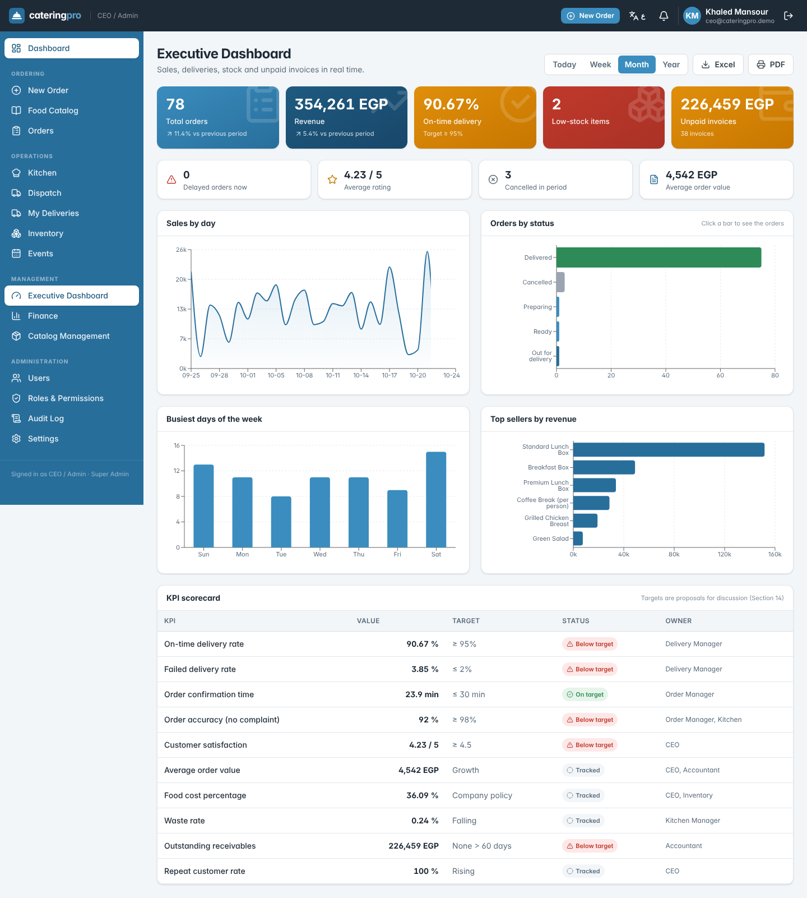

# CateringPro — Catering Company Portal

A working prototype of the full company portal described in **Catering Management System — Business Requirements v4.0**.
One web application with ten role-based interfaces: customers order and track online, and the kitchen, inventory, delivery,
finance and management teams all work from the same order record.



## What it does

| Area | Highlights | Requirements |
|---|---|---|
| **Order Builder** | 5-step wizard (type → method → quantity & schedule → customization → review), four ordering modes, live price breakdown, availability check, minimum quantity, lead time, delivery zone, time-slot capacity with "nearest free time" suggestion, drafts, reorder | UC-01, UC-08, FR-02–FR-11, FR-51–FR-56, FR-87, UI-08, UI-09 |
| **Pricing** | Subtotal + delivery + service fee − discount + tax; paid swaps/extras; 5% quantity discount at 100+ units; price snapshot per order line | FR-59–FR-63, BR-20 |
| **Order lifecycle** | Enforced status transitions (Section 13.1), full status history, change proposal → customer approval, cancellation cut-off, Delayed as a flag, background job that flags late orders | FR-13, FR-17, FR-79–FR-82, BR-02, BR-27–BR-29 |
| **Inventory** | Recipe explosion → ingredient needs; reservation on confirmation, release on cancellation, issue earliest-expiry-first when production starts; expired batches never used; shortage blocks confirmation and alerts inventory; goods in, waste, movements | UC-10, FR-64–FR-71, BR-23–BR-25 |
| **Kitchen** | Production board without prices, allergy notes highlighted, allergen check required before dispatch, daily schedule totalled by dish, printable packing labels | FR-37, FR-72, FR-93–FR-95, BR-32 |
| **Delivery** | Dispatch board, assign only available drivers, reassign (both notified), reschedule failed deliveries, phone-first driver view with proof of delivery / failure reason | UC-03, FR-19–FR-25, FR-103, FR-104 |
| **Finance** | Invoice from the order snapshot, payments (partial allowed), Overdue job, ageing report, monthly collections, Excel export | FR-40, FR-96–FR-98 |
| **Executive** | KPI tiles with period filter and trend, drill-down to orders, sales / status / weekday / top-seller charts, the 10-KPI scorecard from Section 14, Excel and PDF export | UC-04, FR-26–FR-30 |
| **Access control** | Ten roles; permissions stored as data and editable in a matrix; **every API request is checked on the server**; refused attempts written to the audit log; account lockout after 5 failed logins | UC-05, UC-06, FR-31–FR-43, NFR-08, NFR-09, NFR-11 |
| **Also** | Notification centre, Arabic/English with right-to-left layout, catalog management, event planning view, system settings, Swagger API docs, health check | FR-84–FR-85, FR-99, FR-100, NFR-19, NFR-23 |

## Run it

### Option A — Docker (one command)
```bash
docker compose up --build
```
Portal: <http://localhost:8080> · API docs: <http://localhost:3000/api/docs>. Demo data loads automatically on first start.

### Option B — on your machine
Requirements: **Node.js 20+** and **PostgreSQL 14+**.

```bash
# 1. database (once)
psql -U postgres -c "CREATE USER catering WITH PASSWORD 'catering' CREATEDB;"
psql -U postgres -c "CREATE DATABASE catering OWNER catering;"

# 2. install
npm run install:all
cp apps/api/.env.example apps/api/.env      # edit DATABASE_URL if needed

# 3. create tables + demo data (run again any time to start the demo fresh)
npm run db:reset

# 4. start (two terminals)
npm run dev:api      # http://localhost:3000/api   docs: /api/docs
npm run dev:web      # http://localhost:5173
```

## Demo accounts

Password for every account: **`Demo@123`** — the login page also has one-click buttons for each role.

| Role | Email | Home screen |
|---|---|---|
| Customer | customer@cateringpro.demo | Customer Portal |
| Order Manager | ordermanager@cateringpro.demo | Order Management |
| Kitchen Staff | kitchen@cateringpro.demo | Kitchen Dashboard |
| Delivery Manager | delivery@cateringpro.demo | Dispatch |
| Driver | driver@cateringpro.demo (also driver2, driver3) | Driver View |
| Inventory Manager | inventory@cateringpro.demo | Inventory |
| Accountant | accountant@cateringpro.demo | Invoices & Payments |
| CEO / Admin (Super Admin) | ceo@cateringpro.demo | Executive Dashboard |
| Catalog Manager | catalog@cateringpro.demo | Catalog Management |
| Event Coordinator | events@cateringpro.demo | Event Planning |

Other customers: `omar@nilebank.demo`, `sara@deltaevents.demo`.

The seed creates 60 days of order history (for the dashboards) and live orders at every stage, so every role has work waiting.

## Presentation demo script (Section 15.3)

Run `npm run db:reset` before presenting. Each step is automated in `e2e/demo-script.cjs` (`npm run demo` with both servers running), and the screenshots are in `docs/screenshots/`.

| # | Role | Action | What it proves |
|---|---|---|---|
| 1 | Customer | Catalog → *Standard Lunch Box* → *Order this* → Customized package, 50 boxes, 10 vegetarian swaps, allergy note | Catalog, Order Builder, customization rules |
| 2 | Customer | Review the price breakdown and availability → *Submit order* | Pricing, validation, order number |
| 3 | Order Manager → Customer | Open the seeded pending Acme order → *Change time or price* → customer *Approve* (the order is confirmed) | Approval loop (FR-11, BR-02) |
| 4 | Order Manager | Open the order from step 2 → *Confirm order* | Stock reserved, production order and invoice created |
| 5 | Kitchen | *Start preparing* → *Mark ready* (refused until the allergen box is ticked) | Kitchen view, BR-32 |
| 6 | Delivery Manager | *Assign driver* → Karim | BR-03 |
| 7 | Driver (phone) | *Delivered* with recipient name | Driver view, proof of delivery |
| 8 | Customer | See the timeline → *Rate this order* | Tracking, history, rating |
| 9 | Accountant | *Record payment* on the invoice | Invoice from the price snapshot |
| 10 | CEO | Executive dashboard → click *Delayed orders now* | KPIs and drill-down |
| 11 | Driver | Type `/finance` in the address bar | Server refuses; CEO sees it in *Audit Log → Access denied* |

Nice extras to show: switch to **العربية** (top bar), flag an order as delayed, try confirming an order of 60 *Premium Lunch Box* (sea bass shortage blocks it), toggle a permission in *Roles & Permissions* and watch the menu change for that role.

## Architecture

```
React + TypeScript SPA (Vite, Tailwind, TanStack Query, Recharts, i18next)
        │  /api  (JWT)
NestJS REST API ── global AuthGuard: authentication + permission check on every request, audit on denial
  ├─ catalog · pricing · orders (lifecycle) · production · inventory · delivery · finance
  ├─ notifications · dashboards · admin (users, roles, audit, settings) · events
  └─ background jobs (delay flagging, overdue invoices)
        │  Drizzle ORM
PostgreSQL (28 tables, money in NUMERIC)
```

```
apps/
  api/   src/<module>/{*.controller,*.service}.ts   src/db/schema.ts (data model)   src/db/seed.ts   test/api.spec.ts
  web/   src/pages/*.tsx (one per screen)   src/components/   src/ar.ts (Arabic)
e2e/demo-script.cjs     docs/screenshots/
```

Key files when reviewing the business rules:
- `apps/api/src/orders/lifecycle.ts` — allowed status transitions (Section 13.1)
- `apps/api/src/pricing/pricing.service.ts` — pricing formula, validation, recipe explosion, availability
- `apps/api/src/orders/order-ops.service.ts` — confirmation: reservation, production order, invoice
- `apps/api/src/common/auth.guard.ts` — server-side permission check + audit
- `apps/api/src/common/permissions.ts` — permission catalogue and the role matrix (Section 2.3)

## Tests

```bash
npm test          # 24 API tests on a separate <db>_test database (created automatically)
npm run demo      # end-to-end browser run of the 11 demo steps (needs both servers + `npx playwright install chromium`)
```

The API tests cover pricing math, validation, lockout, RBAC refusals and audit, customer data isolation, the lifecycle,
recipe-based reservation, release on cancellation, the allergen gate, driver ownership, price snapshots, shortage blocking and the change-approval loop.

## Notes

- **ORM:** the requirements proposed Prisma. The prototype uses **Drizzle ORM** instead: it is pure TypeScript with no engine binaries to download, which keeps setup and CI simpler. Everything else in the proposed stack is unchanged.
- **Prototype limits (next phase):** editing package contents and recipes from the screen, recurring orders, corporate multi-user accounts, the full quotation workflow for events, online payment, email/SMS delivery of notifications (in-app only today; password-reset links are printed in the API log), and photo upload for proof of delivery.
- All prices, quantities and KPI targets are illustrative sample data.
